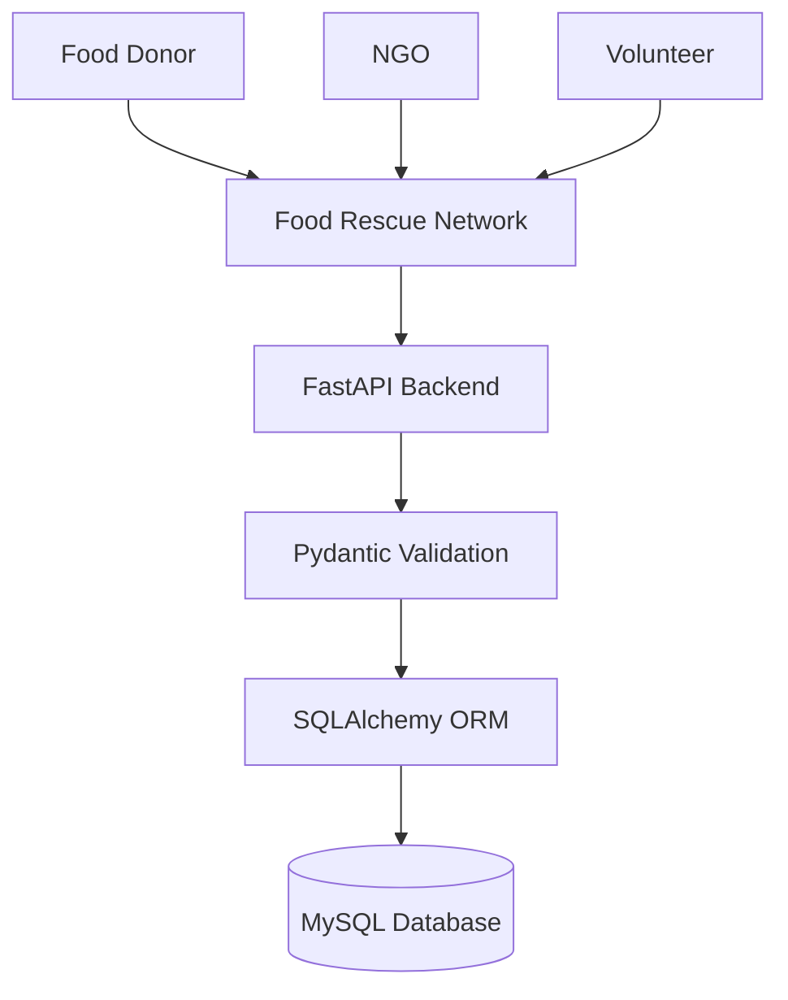
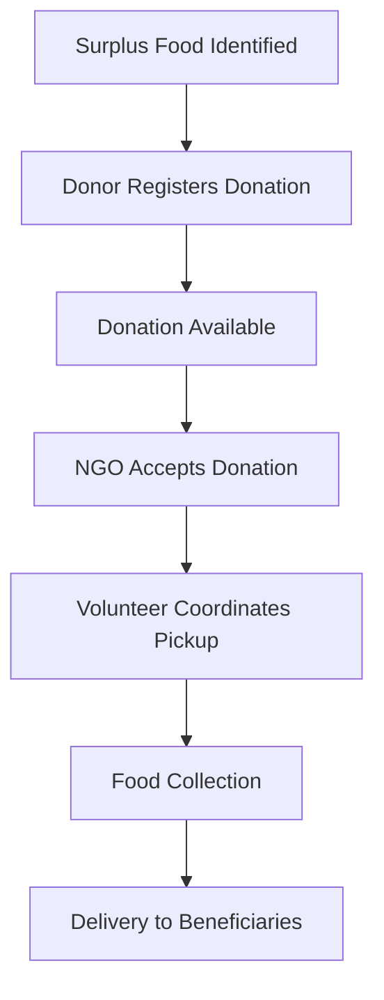

# Food Rescue Network

### Connecting Surplus Food with Those Who Need It.

<p align="center">
  A web-based food redistribution platform connecting food donors, NGOs, and volunteers to reduce food wastage through coordinated donation management.
</p>

<p align="center">
  
  
  
  
</p>

---

## About the Project

Food wastage and food insecurity are two interconnected challenges. While restaurants, hotels, and individuals often have surplus food, many communities struggle to access sufficient meals.

**Food Rescue Network** aims to bridge this gap through a centralized digital platform that simplifies food donation, acceptance, collection, and distribution.

The platform brings together three key stakeholders:

- **Food Donors:** Share details of surplus food available for donation.
- **NGOs:** Discover and accept suitable food donations.
- **Volunteers:** Coordinate food collection and delivery.

The primary objective is to make food redistribution more organized, accessible, and efficient.

## Key Features

- **Food Donation Management:** Register and manage surplus food donations.
- **Donor Management:** Maintain donor information and donation records.
- **NGO Coordination:** Enable NGOs to discover and accept available donations.
- **Volunteer Coordination:** Support food collection and delivery activities.
- **Donation Tracking:** Monitor donation progress from availability to delivery.
- **REST API:** Backend services for application operations.
- **Database Integration:** Structured storage and management of application data.

## Technology Stack

| Component | Technology |
|---|---|
| Programming Language | Python |
| Backend Framework | FastAPI |
| Database | MySQL |
| ORM | SQLAlchemy |
| Data Validation | Pydantic |
| API Documentation | Swagger UI / OpenAPI |

## System Architecture



## Donation Workflow



**Donation Lifecycle:**

`AVAILABLE` → `ACCEPTED` → `PICKED_UP` → `DELIVERED`

## Project Structure

```text
Food-Rescue-Network/
│
├── backend/
│   ├── main.py
│   ├── models.py
│   ├── schemas.py
│   ├── database.py
│   └── routes/
│
├── frontend/
│
├── database/
│   └── food_rescue_network.sql
│
├── requirements.txt
├── .gitignore
└── README.md
```

*Note: Update the directory structure according to the actual files in your repository.*

## Getting Started

### Prerequisites

- Python 3.x
- MySQL Server
- Git
- pip

### 1. Clone the Repository

```bash
git clone https://github.com/YOUR-USERNAME/Food-Rescue-Network.git
```

### 2. Navigate to the Project Directory

```bash
cd Food-Rescue-Network
```

### 3. Create a Virtual Environment

```bash
python -m venv venv
```

Activate the environment:

**Windows:**
```bash
venv\Scripts\activate
```

**macOS / Linux:**
```bash
source venv/bin/activate
```

### 4. Install Dependencies

```bash
pip install -r requirements.txt
```

### 5. Configure the Database

- Start your MySQL server.
- Create the required database.
- Configure database credentials using environment variables.
- Execute the provided SQL scripts, if applicable.

### 6. Run the Backend Server

```bash
cd backend
python -m uvicorn main:app --reload
```

### 7. Access API Documentation

Once the server is running, open:

- **Swagger UI:** http://127.0.0.1:8000/docs
- **ReDoc:** http://127.0.0.1:8000/redoc

## Future Enhancements

- Real-time donation notifications.
- GPS-based NGO and volunteer matching.
- Food expiry and quality monitoring.
- Interactive donation analytics dashboard.
- Mobile application integration.
- Role-based authentication and access control.
- Location-based donation discovery.

## Social Impact

Food Rescue Network aims to contribute towards a more sustainable food distribution ecosystem by:

- Reducing avoidable food wastage.
- Improving access to surplus food.
- Supporting NGOs and community organizations.
- Encouraging volunteer participation.
- Promoting responsible resource utilization.

## Contributors

Developed as an academic software development project.

## License

This project is intended for educational and development purposes. Licensing terms can be added when the project is ready for public distribution.

---

<p align="center">
  <b>Food Rescue Network</b><br/>
  Turning Surplus into Support. Building a More Sustainable Tomorrow.
</p>
